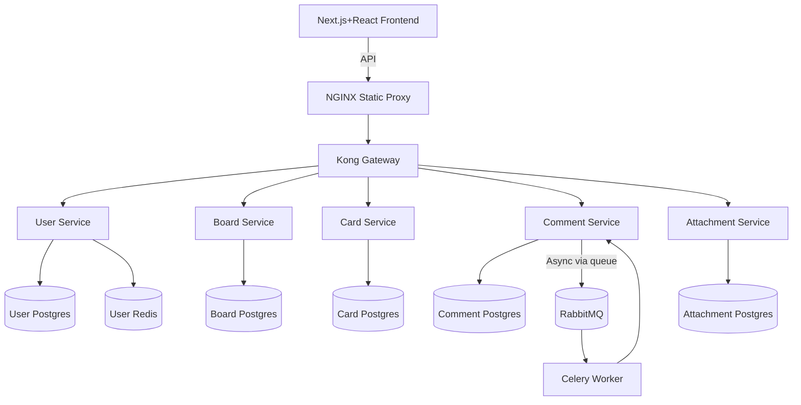

# Final Microservices Architecture: Trello-like App

## Overview
All frontend API requests are routed via Kong Gateway to dedicated microservices. Each service has its own DB, optional cache, and async queue integration as needed for scalable, modular operation.

---

## Architecture Diagram (Mermaid)

---

## Service Responsibilities

- **User Service**: Handles user registration, authentication, profile, JWT, and session Redis cache.
- **Board Service**: CRUD on boards/lists, participants, and permissions.
- **Card Service**: CRUD on cards/todos, checklists, status, drag & drop.
- **Comment Service**: Comment creation, listing; triggers notifications via Celery+RabbitMQ.
- **Attachment Service**: File upload endpoints, S3/MinIO/cloud storage-ready.

## API Gateway: Kong
- Routes: `/api/*` paths to appropriate microservices
- Plugins: JWT Auth, CORS, Rate Limiting, Logging
- Load balancing & health check for microservice endpoints

## Async Processing
- **RabbitMQ**: Main message broker
- **Celery**: Handles notifications, emails, background jobs in comment/other services

## Databases
- Separate PostgreSQL instance per microservice (full logical isolation and migration independence)

## Cache
- Redis for user sessions & token blacklists (per user_service; add more caches as usage grows)

## Frontend
- Next.js (React)
- NGINX static asset proxy & SSR/api fallback

## Best Practices Noted
- Strict environment separation via .env, secrets not checked into code
- Kong in DB mode for dynamic config (optionally declarative)
- Health endpoints for all services
- Logging to stdout/stderr for container health
- CI/CD ready for container builds & migrations
- JWT and rate limiting for security
- All services use Alembic/Flask-Migrate for migrations

---

## Notes
- To add more async or background task capacity, scale Celery workers and plug into additional microservices as needed.
- Add more Kong plugins for production: advanced rate limiting, logging, admin API protection (auth), cloud storage config for attachments, etc.
- All endpoints should be gated by auth/JWT where user context is needed.
