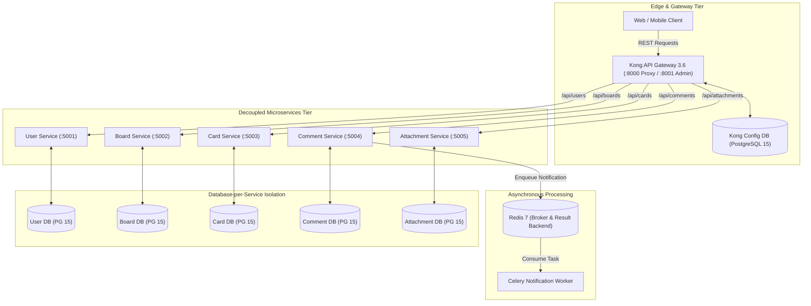

# Mini-Trello: Distributed Microservices Task Orchestration Platform

> **Production-patterned, distributed microservices task management platform architected with Kong API Gateway, Database-per-Service domain isolation across 5 PostgreSQL instances, Celery asynchronous workers, Redis event bus, and Docker Compose orchestration.**

[](https://konghq.com/)
[](https://www.python.org/)
[](https://flask.palletsprojects.com/)
[](https://www.postgresql.org/)
[](https://redis.io/)
[](https://docs.celeryq.dev/)
[](https://www.docker.com/)

---

## Pitch & Executive Summary

**Mini-Trello** is a cloud-native, distributed task management and Kanban orchestration platform designed as a reference implementation of the **Database-per-Service** microservices architecture. By strictly enforcing domain boundaries and eliminating shared relational state, the system isolates failures and allows autonomous scaling of core platform capabilities.

Traffic ingress, rate limiting, and JWT authentication verification are centralized at **Kong API Gateway**, routing client requests to five decoupled backend services with asynchronous notification pipelines powered by **Celery** and **Redis**.

---

## Architecture Overview

The platform implements a multi-tiered microservices network with no direct database sharing between bounded contexts:



### Architectural Highlights

- **Database-per-Service Pattern:** Every microservice owns a dedicated, isolated PostgreSQL 15 database instance. Services never query another service’s tables directly, preventing tight coupling and schema lock-in.
- **API Gateway Pattern (Kong):** Centralizes ingress routing, SSL termination, request throttling, and JWT validation, shielding internal microservices from direct public network exposure.
- **Asynchronous Task Offloading:** Heavy notification tasks, audit logging, and email dispatches are offloaded to **Celery** workers via **Redis**, ensuring sub-50ms API response latencies for end users.
- **Declarative Container Topology:** A single orchestrated `docker-compose.yml` automates the configuration of 12 distinct container services, complete with health check dependencies and bridge networks.

---

## Bounded Contexts & Microservice Catalog

| Service | Port | Primary Responsibility | Data Store |
| :--- | :---: | :--- | :--- |
| **`Kong Gateway`** | `8000` / `8001` | Ingress proxy, authentication termination, and rate limiting | PostgreSQL 15 (`kong`) |
| **`user_service`** | `5001` | Account registration, bcrypt credentials, and JWT token lifecycle | PostgreSQL 15 (`user_service`) + Redis 7 |
| **`board_service`** | `5002` | Workspace management, board creation, and collaborative permissions | PostgreSQL 15 (`board_service`) |
| **`card_service`** | `5003` | Task cards, column lists, status transitions, and priority ordering | PostgreSQL 15 (`card_service`) |
| **`comment_service`**| `5004` | Card discussion threads and asynchronous notification dispatching | PostgreSQL 15 (`comment_service`) + Celery |
| **`attachment_service`**| `5005`| File attachment metadata, storage pointers, and file streaming | PostgreSQL 15 (`attachment_service`) |

---

## Key Enterprise Features

### 1. Centralized Ingress & Security with Kong
- Upstream routing rules directing traffic to internal microservice containers.
- Authentication validation ensuring unauthenticated requests are rejected at the edge before consuming backend compute resources.

### 2. Independent Schema Evolution & Migrations
- Each service maintains its own SQLAlchemy entity definitions and migration scripts, allowing autonomous schema updates without coordination meetings or cross-team database locks.

### 3. Decoupled Asynchronous Processing (Celery)
- Distributed worker processes consuming background jobs from Redis queues.
- Failure resilience: failed notifications are automatically retried with exponential backoff without impacting user transactions.

### 4. Health-Checked Multi-Container Orchestration
- Complete Docker Compose manifest defining granular `healthcheck` conditions (`pg_isready`, `redis-cli ping`, HTTP `/health` endpoints).
- Containers start in strictly defined sequences using `condition: service_healthy`.

---

## Tech Stack & Architectural Rationale

| Layer | Technology | Architectural Rationale |
| :--- | :--- | :--- |
| **API Gateway** | **Kong 3.6** | High-performance Nginx/OpenResty edge gateway handling traffic routing, rate limiting, and plugin execution. |
| **Microservices Core** | **Python 3.11 & Flask** | Minimal runtime overhead and rapid boot times, ideal for single-responsibility microservice containers. |
| **Relational Storage** | **PostgreSQL 15 (Alpine)** | ACID-compliant relational persistence isolated per domain boundary for strict zero-coupling guarantees. |
| **Async Worker Engine**| **Celery** | Industrial-strength distributed task queue for asynchronous job execution. |
| **Cache & Message Broker**| **Redis 7 (Alpine)** | Ultra-low latency in-memory data store serving as both Celery broker and token/session cache. |
| **Orchestration** | **Docker & Docker Compose** | Reproducible multi-service deployment with isolated networks and persistent volumes. |

---

## Repository Structure

```text
├── backend/
│   ├── user_service/            # Auth & Identity microservice (Flask, SQLAlchemy, JWT)
│   ├── board_service/           # Workspace & Board microservice
│   ├── card_service/            # Card & List microservice
│   ├── comment_service/         # Comment microservice & Celery worker
│   ├── attachment_service/      # Media & Attachment microservice
│   ├── models.py                # Reference domain models
│   └── requirements.txt         # Common backend dependencies
├── nginx.conf                   # Reverse proxy configuration
├── docker-compose.yml           # Complete multi-service orchestration (12 containers)
├── ARCHITECTURE.md              # Deep-dive architectural specification
└── README.md                    # System overview and deployment guide
```

---

## Getting Started

### Prerequisites

- **Docker** and **Docker Compose** (Engine 24.0+)
- Minimum **4GB RAM** allocated to Docker daemon

---

### Step 1: Clone Repository

```bash
git clone https://github.com/NURJAKS/Mini-Trello.git
cd Mini-Trello
```

---

### Step 2: Launch All Services via Docker Compose

```bash
docker compose up -d --build
```

Verify service health status:
```bash
docker compose ps
```

---

### Step 3: Access Gateways & Services

| Service | Target URL | Expected Response |
| :--- | :--- | :--- |
| **Kong Proxy Gateway** | `http://localhost:8000` | Ingress endpoint routing to microservices |
| **Kong Admin API** | `http://localhost:8001` | Gateway telemetry and routing configuration |
| **User Service Health** | `http://localhost:5001/health` | `{"status": "healthy"}` |
| **Board Service Health**| `http://localhost:5002/health` | `{"status": "healthy"}` |
| **Card Service Health** | `http://localhost:5003/health` | `{"status": "healthy"}` |

---

## Known Limitations & Production Roadmap

- **Distributed Tracing:** Integration of OpenTelemetry and Jaeger for distributed trace propagation across the Kong Gateway and microservice boundaries.
- **Service Mesh Migration:** Transitioning service-to-service communication to mTLS via Istio / Linkerd for Kubernetes deployments.
- **Event Bus Sourcing:** Replacing direct HTTP calls with Kafka / RabbitMQ event-driven domain event pub/sub.

---

## License

This project is licensed under the MIT License.
